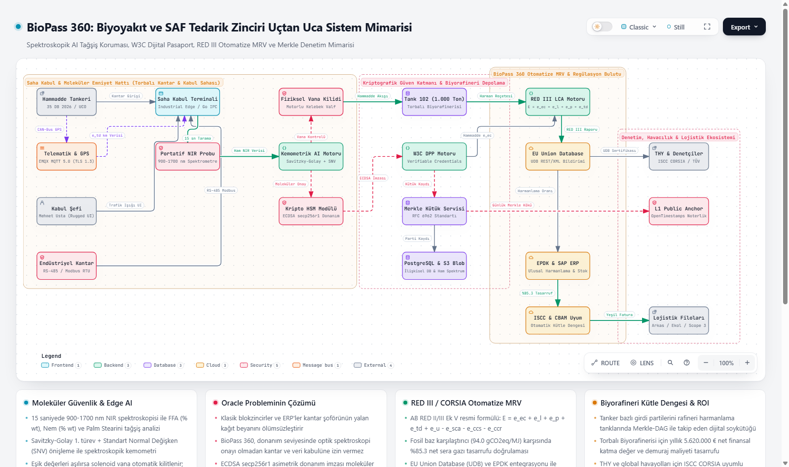

# 🌿 BioPass 360

> **Biyoyakıt ve SAF Tedarik Zincirinde Spektroskopik AI Hammadde Pasaportu & RED III / CORSIA Otomatize MRV Platformu**  
> *DEKATHON 2026 — Dokuz Eylül Teknoloji Geliştirme Bölgesi & DB Tarımsal Enerji İş Birliğiyle*

[](https://biopass360.onrender.com)
[](https://biopass360.onrender.com)
[](https://cdn.jsdelivr.net/gh/cirutsohtorik/biopass360@ee43730/docs/brag.mp4)
[](https://biopass360.onrender.com)
[](src/biopass360)
[](src/biopass360/mrv)

---

## 🎬 Proje Tanıtım & Pitch Videosu

> ▶️ **[Tanıtım Videosunu İzlemek İçin Tıklayın (BioPass 360 Tanıtım Videosu)](https://cdn.jsdelivr.net/gh/cirutsohtorik/biopass360@ee43730/docs/brag.mp4)**  
> 🌐 *Ayrıca [Canlı Web Sitemiz](https://biopass360.onrender.com) üzerinde sağ üstteki kırmızı **"Tanıtım Videosu"** butonuna basarak sayfadan ayrılmadan da izleyebilirsiniz.*

---

## 🌐 Canlı Etkileşimli Sistem Mimarisi & Diyagramı

BioPass 360 uçtan uca veri akışını, saha IoT entegrasyonlarını, Edge AI analizini ve regülasyon denetim adımlarını görselleştiren **tam etkileşimli mimari sayfası** Render üzerinde yayındadır:

👉 **[https://biopass360.onrender.com](https://biopass360.onrender.com)**

[](https://biopass360.onrender.com)

---

## 📌 Yönetici Özeti (Barbara Minto SCQA Çerçevesi)

```
[SITUATION - Durum]
AB RED III Direktifi, ReFuelEU Aviation ve THY'nin DB Tarımsal Enerji'ye $42M stratejik
yatırımıyla SAF (Sürdürülebilir Havacılık Yakıtı) ve Biyodizel talebi patlamıştır.
                           │
                           ▼
[COMPLICATION - Sektörel Kriz]
UCO (Atık Yağ) ton başına $300-$400 yeşil prim sağladığı için piyasada taze palm yağı
asitlendirilerek UCO gibi satılmaktadır (tağşiş). Mevcut ERP ve blokzincirler fiziksel içeriği
değil yalnızca kağıt faturayı kaydeder ("Oracle Problemi"). Lab testleri 24-48 saat sürer;
rafineri ya demuraj cezası öder ya da katalizör zehirlenmesi ve ISCC lisans iptali riskiyle karşılaşır.
                           │
                           ▼
[QUESTION - Soru]
DB Tarımsal Enerji kapısındaki hammaddeyi 15 saniyede moleküler olarak doğrulayıp
kütle dengesini, karbon yoğunluğunu ve ihracat primini nasıl garanti altına alırız?
                           │
                           ▼
[ANSWER - Çözüm: BioPass 360]
Portatif NIR Spektrometre + Edge AI Kemometri + W3C Uyumlu Dijital Hammadde Pasaportu (DPP)
+ RED III / ISO 14064 Otomatize MRV Motoru!
```

---

## 🚀 Temel Fonksiyonel Modüller

### 1. 🔬 Spektroskopik AI Tağşiş & Kalite Motoru (`src/biopass360/spectral/`)
- **Portatif NIR/FTIR Entegrasyonu:** 900–1700 nm dalga boyunda ham spektral absorbanstan 15 saniyede kimyasal parmak izi analizi.
- **Kemometrik Analiz:** Savitzky-Golay türevi, Standart Normal Değişken (SNV) dönüşümü ve PCA/PLS-DA modelleri.
- **Parametre Kestirimi:** Serbest Yağ Asitleri (FFA % wt), Nem & Uçucu Madde (% wt), İyot Değeri (IV) ve Palm Stearini Tağşiş Yüzdesi.
- **Otomatik Kapı Kararı:** `ACCEPTED` (Yeşil), `WARNING_BORDERLINE` (Sarı), `REJECTED_ADULTERATED` (Kırmızı - otomatik vana kilidi).

### 2. 🌱 RED III & CORSIA Otomatize MRV / LCA Motoru (`src/biopass360/mrv/`)
- **AB RED II / RED III Ek V Standart Formülasyonu:**
  $$E = e_{ec} + e_l + e_p + e_{td} + e_u - e_{sca} - e_{ccs} - e_{ccr}$$
- **Fosil Yakıt Karşılaştırıcı:** $EF_{Fossil} = 94.0\text{ gCO}_2\text{eq/MJ}$ (Biyodizel) ve $89.0\text{ gCO}_2\text{eq/MJ}$ (SAF).
- **Otomatik GHG Tasarruf Hesabı:** Partinin minimum %65-%85 tasarruf eşiğini sağlayıp sağlamadığını gerçek zamanlı hesaplayarak ISCC / AB Union Database (UDB) formatında raporlar.

### 3. 📜 W3C Uyumlu Dijital Hammadde Pasaportu (DPP) (`src/biopass360/passport/`)
- **Kriptografik İmzalı Verifiable Credential:** JSON-LD tabanlı, ECDSA (secp256r1) imzalı menşe, kantar, spektroskopi ve karbon sertifikası.
- **Merkle Tree Denetim Kanıtı:** Her kabul partisi Merkle-DAG'e eklenir; üçüncü taraf denetçiler (ISCC/TÜV) sıfır bilgi kanıtıyla (Proof of Inclusion) veriyi doğrular.

### 4. ⚡ Production-Ready REST API (`src/biopass360/api/`)
- Parti oluşturma, spektral tarama gönderimi, LCA hesaplama, dijital imza doğrulama ve parti sorgulama uç noktaları.

---

## 📂 Dizin ve Dokümantasyon Haritası

```
biopass360/
├── index.html                   # Canlı etkileşimli mimari diyagramı (biopass360.onrender.com)
├── README.md                    # Bu doküman (proje rehberi)
│
├── src/biopass360/              # BioPass 360 Çekirdek Kaynak Kodları
│   ├── api/
│   │   └── endpoints.py         # FastAPI REST servis uç noktaları
│   ├── mrv/
│   │   ├── lca_engine.py        # RED III / CORSIA sera gazı LCA motoru (Python)
│   │   └── lca_engine.ts        # TypeScript / Edge MRV motoru
│   ├── passport/
│   │   ├── schema.py            # W3C DPP JSON-LD veri şeması modelleri
│   │   └── signer.py            # Kriptografik ECDSA imzalayıcı & doğrulayıcı
│   └── spectral/
│       ├── adulteration_detector.py # Tağşiş tespit mantığı & kalite sınıflandırıcısı
│       ├── chemometrics.py      # Spektral önişleme & kemometri motoru
│       └── mock_sensor.py       # NIR sensör simülatörü & spektrum üreticisi
│
├── tests/                       # Doğrulama ve Birim Testleri
│   ├── test_lca_engine.py       # RED III GHG hesaplama testleri
│   ├── test_passport_schema.py  # W3C DPP ve Merkle doğrulama testleri
│   └── test_spectral_analysis.py# NIR spektroskopi & tağşiş tespit testleri
│
└── docs/                        # Kapsamlı Şartname ve Proje Dosyaları
    ├── BIOPASS360_SYSTEM_ARCHITECTURE.md    # C4 Seviye 1/2/3 mimari ve teknik spesifikasyon
    ├── BIOPASS360_UX_SPECIFICATION.md        # Operatör arayüzü, Don Norman ergonomi spesifikasyonu
    ├── DEKATHON2026_BIOPASS360_PROJE_DOSYASI.md # DEKATHON 2026 Jüri & Şampiyonluk proje dosyası
    ├── BioPass360_DEKATHON2026_Proje_Ozeti.pdf # 3 sayfalık yönetici PDF özeti
    ├── biopass360_summary.html              # HTML formatında yönetici özeti
    └── screenshot-archify.png               # Etkileşimli mimari diyagram önizlemesi
```

---

## 🧪 Birim Testlerini Çalıştırma

Tüm çekirdek algoritmalar standart kütüphanelerle çalışabilecek şekilde tasarlanmıştır:

```bash
# Tüm birim testlerini çalıştır
python -m unittest discover -s tests -p "test_*.py"

# Bireysel test paketleri
python -m unittest tests/test_lca_engine.py
python -m unittest tests/test_passport_schema.py
python -m unittest tests/test_spectral_analysis.py
```

---

## 🏆 DEKATHON 2026 Bağlamı & Katkı

BioPass 360, **Dokuz Eylül Teknoloji Geliştirme Bölgesi (DEPARK BAMBU GO)** ve Türkiye'nin ilk ISCC CORSIA sertifikalı SAF üreticisi olan **DB Tarımsal Enerji** ortaklığıyla düzenlenen **DEKATHON 2026 (Ulaşımda Karbonsuzlaşma Ideathonu)** için geliştirilmiştir.

- **Canlı Mimari:** [https://biopass360.onrender.com](https://biopass360.onrender.com)
- **Depo:** [https://github.com/cirutsohtorik/biopass360](https://github.com/cirutsohtorik/biopass360)
