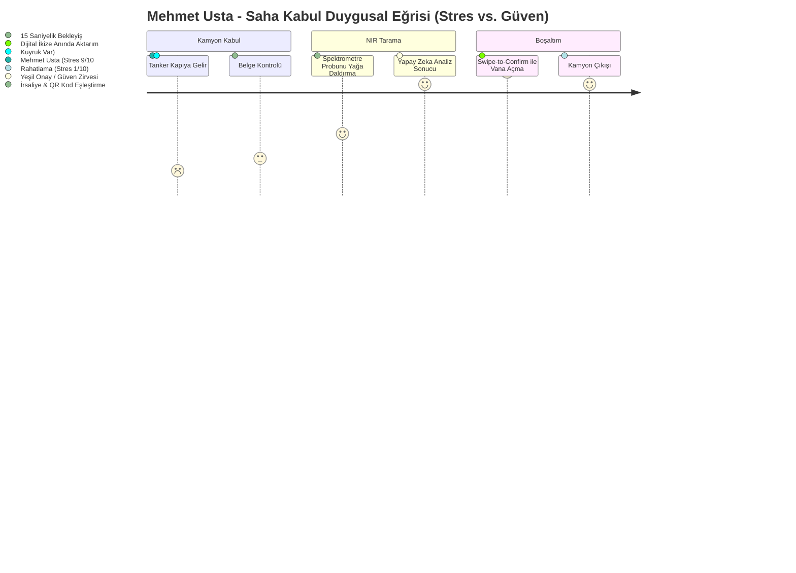

# BioPass 360 — UX Tasarım, Kokpit & Sunum Spesifikasyonu
**DEKATHON 2026: Ulaşımda Karbonsuzlaşma Ideathonu**  
**Tasarım Disiplini:** İnsan merkezli tasarım ve hedef odaklı persona yaklaşımı

---

## 1. YÖNETİCİ ÖZETİ VE TASARIM VİZYONU

### 1.1 Problem Tanımı & Operasyonel Gerçeklik
Biyoyakıt tedarik zinciri (özellikle Kullanılmış Kızartma Yağları - UCO), endüstriyel lojistiğin en karmaşık, suistimale en açık ve regülasyon baskısının en yüksek olduğu alanlardan biridir.
- **Tağşiş Riski:** UCO, RED III Annex IX Part B kapsamında teşvikli bir hammadde olduğu için, sahte UCO (palm stearin veya geri dönüştürülmüş madeni yağ katkılı) piyasada sıkça görülmektedir.
- **RED III Baskısı:** Avrupa Birliği Yenilenebilir Enerji Direktifi III (RED III), ham maddenin kaynağından rafineri çıkışına kadar her gram CO2 eşdeğerinin (gCO2eq/MJ) ispatlanmasını ve ISCC (International Sustainability and Carbon Certification) denetimlerinden hatasız geçilmesini zorunlu kılmaktadır.
- **Saha Çıkmazı:** Rafineri kapısında kuyrukta bekleyen tankerlerin numune analizleri geleneksel laboratuvarlarda saatler mertebesinde sürerken, kabul şefinin karar vermek için sadece **3 dakikası** vardır. Yanlış kabul parti kontaminasyonu ve sertifikasyon riskine; haksız ret ise filo krizine ve tedarikçi kaybına yol açar.

### 1.2 Tasarım Felsefemiz
- **İnsan Merkezli Tasarım:** 
  - *Affordance & Signifiers:* Ağır sanayi şartlarında (yağlı eldivenler, parlak güneş ışığı, gürültülü pompa sesleri) hata payını sıfıra indiren dev dokunmatik hedefler, anında anlaşılır trafik ışığı renk kodlaması ve çok duyulu (haptic + ses + görsel) geri bildirimler.
  - *Mistake Prevention (Hata Önleme):* Kritik kararlarda (örneğin tanka boşaltım vanasını açma veya sahte partiyi karantinaya alma) kazara basmayı önleyen "Swipe-to-Confirm" (Kaydırarak Onayla) kilit mekanizmaları.
  - *Conceptual Models:* Kullanıcının zihnindeki zihinsel modelle sistemin çalışma şeklini birebir eşleştiren dijital ikiz ve spektral örtüşme grafikleri.
- **Alan Cooper Disiplini:**
  - *Goal-Directed Design:* Kullanıcıların "görevlerine" değil, nihai "amaçlarına" odaklanma. Mehmet Usta'nın amacı form doldurmak değil, "huzurla eve gitmek ve fabrikayı sahte yağdan korumak"tır. Deniz Hanım'ın amacı rapor hazırlamak değil, "AB denetçisinin karşısında 10 saniyede şüphe bırakmayacak kanıt sunmaktır".

---

## 2. KULLANICI PERSONALARI VE DUYGUSAL YOLCULUKLARI (JOURNEY MAPS)



---

### PERSONA 1: Mehmet Usta (Rafineri Hammadde Kabul Şefi)
- **Demografi:** 52 yaşında, 28 yıllık rafineri ve petrol sahası emektarı. Torbalı / İzmir tesisinde görevli.
- **Çalışma Ortamı:** Koruyucu baret, fosforlu yelek, gres yağlı ağır iş eldivenleri, güneş ışığı altında parlayan endüstriyel tablet / el terminali, arka planda çalışan tanker dizel motorları ve pompa sesleri.
- **Kişisel Hedefleri:**
  1. Kapıdaki kamyon kuyruğunu 5 dakikanın altında eritmek, şoförlerle gereksiz tartışmaya girmemek.
  2. Fabrikaya asla tağşişli (palm yağı veya su karışmış) hammadde sokmamak; aksi takdirde reaktör katalizörleri bozulur ve fatura ona kesilir.
  3. Karmaşık yazılımlarla, küçük butonlarla ve anlaşılmaz kodlarla vakit kaybetmemek.
- **Çözüm:**
  - *Görsel Hiyerarşi:* Tüm ekran tek bir baskın soruya cevap verir: **"BU YAĞ TEMİZ Mİ, BOŞALTAYIM MI?"**
  - *Trafik Işığı Semantiği:* 
    - 🟢 **BÜYÜK YEŞİL KART:** UCO Saf (%97.4 Eşleşme). FFA: %3.1, Nem: %0.08. Tek hareketle sağa kaydır -> "Giriş İzni Ver".
    - 🔴 **YANIP SÖNEN KIRMIZI ALARM:** Tağşiş Algılandı (%28 Palm Yağı Stearini). Haptik titreşim + yüksek frekanslı onaylama sireni. Tanka giden otomatik selenoid valf kilitlenir.
    - 🟡 **SARI UYARI:** Sınırda Değer (Nem %0.75). "Ekstra Numune Al" veya "Laboratuvara Sevk Et".
  - *Fiziksel Ergonomi:* Minimum 64x64 piksel dokunma alanları, eldiven dostu büyük kartlar, dış mekan yüksek kontrastlı (Ultra High Contrast Dark/Light Mode) arayüz.

---

### PERSONA 2: Deniz Hanım (Sürdürülebilirlik & İhracat Direktörü)
- **Demografi:** 38 yaşında, Çevre Yüksek Mühendisi & Sürdürülebilirlik Yönetimi Yüksek Lisanslı. DB Tarımsal Enerji İzmir Genel Merkezinde görevli.
- **Çalışma Ortamı:** Çift monitörlü çalışma istasyonu, Brüksel ve Frankfurt ile yapılan kritik video konferanslar, ISCC EU denetim dosyaları, RED III mevzuat dökümanları.
- **Kişisel Hedefleri:**
  1. AB'ye ihraç edilen her metrik ton Biyodizel / HVO yakıtının ISCC sertifikasyonunu garanti altına almak.
  2. Olası bir denetimde (Audit) rastgele seçilen herhangi bir partinin tarladan/restorandan rafineri kapısına kadar olan tüm karbon izini 10 saniye içinde belgeli olarak sunabilmek.
  3. RED III sınır değerlerini aşan (emisyon tasarrufu <%65 olan) partileri anında yakalamak ve portföyden ayıklamak.
- **Çözüm:**
  - *Zihinsel Model Uyumu:* Kokpit, Deniz Hanım'ın zihnindeki "Tedarik Zinciri Değer Akışı"na göre kurgulanmıştır.
  - *Audit-Ready One-Click Generation:* Denetçi "Parti #8842'yi görelim" dediğinde tek tıkla dijital pasaportun W3C Verifiable Credential ve SHA-256 kriptografik damgalı PDF çıktısı üretilir.
  - *Kümülatif Eşik Çizgisi:* RED III hedef çizgisi (%65 tasarruf eşiği olan max 33.8 gCO2eq/MJ) ile gerçekleşen rafineri ortalaması (14.1 gCO2eq/MJ -> %85.0 Tasarruf) anlık olarak canlı bir hız göstergesi şeklinde sunulur.

---

### PERSONA 3: Can Bey (Lojistik Filo Müdürü)
- **Demografi:** 44 yaşında, 150 tankerlik bağımsız lojistik filosunun operasyon direktörü.
- **Çalışma Ortamı:** Lojistik operasyon merkezi, canlı GPS/telematik takip ekranları, nakliye teklif yazılımları.
- **Kişisel Hedefleri:**
  1. Boş dönüş (deadhead) mesafelerini minimize edip yakıt maliyetlerini düşürmek.
  2. Müşterilerine (büyük rafineriler ve petrokimya devleri) "Yeşil Navlun (Green Freight)" teklifi vererek navlun birim fiyatına %10-15 sürdürülebilirlik primi eklemek.
  3. Scope 3 (Kategori 4 & 9) sera gazı emisyon azaltımını noter güvencesinde resmi bir pasaportla kanıtlamak.
- **Çözüm:**
  - Canbus/FMS telematik verilerini doğrudan BioPass 360 akıllı sözleşmesine bağlayan "Yeşil Navlun Portalı".
  - Tek tıkla oluşturulan "Kapsam 3 Doğrulanmış Yeşil Navlun Sertifikası" QR kodu.

---

## 3. KRİTİK EKRAN TASARIMLARI & UI WIREFRAME KURGUSU

### EKRAN 1: Mobil/Tablet Saha Kabul & NIR Tarama Ekranı (Rugged UI)
**Cihaz:** Samsung Galaxy Tab Active4 Pro / Zebra Rugged Terminal (Darbe ve yağ geçirmez endüstriyel tablet)  
**Kullanıcı:** Mehmet Usta  

```
+-------------------------------------------------------------------------------+
|  BIOPASS 360 // SAHA KABUL TERMINALI                      [Batarya %94] [4G] |
|  Cihaz: SpectroBio-NIR v2 [Bağlı 🟢]    Kullanıcı: Mehmet Usta (Kabul Şefi)   |
+-------------------------------------------------------------------------------+
|  GELEN TANKER: 35 DB 2026                 İRSALİYE: IRS-99420-UCO              |
|  Tedarikçi: Ege Atık Yağ Toplama A.Ş.     Parti Kodu: TR-2026-UCO-8842        |
|  Beyan Edilen Hacim: 24.500 Litre         Hammadde Beyanı: %100 Bitkisel UCO  |
+-------------------------------------------------------------------------------+
|                                                                               |
|   ===================== YAPAY ZEKA NIR ANALİZ SONUCU =====================   |
|                                                                               |
|   +-----------------------------------------------------------------------+   |
|   |  🟢 DURUM: ONAYLANDI (SAF VE UYGUN HAMMADDE)                          |   |
|   |  Yapay Zeka Güven Skoru: %98.4 // Tağşiş Riski: %0.0                 |   |
|   +-----------------------------------------------------------------------+   |
|                                                                               |
|   [Spektral Eğri (NIR 1100 - 2500 nm)]                                        |
|   Absorbans |                                                                 |
|        2.0  |                     ___/\___ (Ölçülen Spektrum: Normal)         |
|        1.0  |           /\_______/        \_____ (Referans UCO ile %99.1 eş)  |
|        0.0  +-------------------------------------> Dalga Boyu (nm)           |
|                 1200    1400    1700    2100   2400                           |
|                                                                               |
|   PARAMETRE DETAYLARI:                                                        |
|   * Serbest Yağ Asitleri (FFA): %3.10  [Eşik: <%5.0]  --> 🟢 UYGUN            |
|   * Nem & Uçucu Madde:          %0.08  [Eşik: <%0.5]  --> 🟢 UYGUN            |
|   * Palm Yağı Stearin İzi:      YOK    [Eşik: <%1.0]  --> 🟢 TEMİZ            |
|   * Madeni / Mineral Yağ İzi:   YOK    [Eşik: 0 ppm]  --> 🟢 TEMİZ            |
|   * İyot Değeri (IV):           114 g I2/100g         --> 🟢 NORMAL UCO       |
|                                                                               |
+-------------------------------------------------------------------------------+
|  İŞLEM EYLEMİ: ('Hata Önleme' Slider Mekanizması)                      |
|                                                                               |
|  >>> [ GİRİŞ İZNİ VER & TANK 102 VANASINI AÇMAK İÇİN SAĞA KAYDIRIN >>> ]      |
|                                                                               |
|  [ ⚠️ ŞÜPHELİ / LABA GÖNDER ]                 [ 🛑 TAĞŞİŞ / REDDET & MÜHÜRLE ]|
+-------------------------------------------------------------------------------+
```

> **Simüle Edilen Kırmızı Alarm Hali (Tağşiş Durumunda Ekranın Değişimi):**
> Ekranın tamamı yüksek kontrastlı **KIRMIZI (Crimson Alert #D32F2F)** renge döner.
> - **BAŞLIK:** `🔴 KRİTİK ALARM: TAĞŞİŞ SAPTANDI (%28 PALM YAĞI STEARİNİ)`
> - **UYARI:** `1720 nm ve 2140 nm dalga boylarında karakteristik palm trigliserid pikleri tespit edildi! Bu parti RED III Madde 29 sürdürülebilirlik kriterlerini ihlal etmektedir.`
> - **SİSTEM KİLİDİ:** Boşaltım vanası fiziksel olarak kilitlenir. Karantina tutanağı otomatik oluşturulur.

---

### EKRAN 2: Biyorafineri Dijital İkiz & MRV Emisyon İzleme Kokpiti
**Cihaz:** Web Tarayıcı / 4K Operasyon İzleme Ekranı  
**Kullanıcı:** Deniz Hanım (Sürdürülebilirlik Direktörü) & Üretim Şefi  

```
+------------------------------------------------------------------------------------------------------------------------+
|  BIOPASS 360  //  BİYORAFİNERİ DİJİTAL İKİZ & MRV KOKPİTİ [İZMİR TORBALI TESİSİ]               13 Ekim 2026 | 17:50   |
+------------------------------------------------------------------------------------------------------------------------+
| [CANLI METRİKLER]                                                                                                      |
|  GÜNLÜK İŞLENEN HAMMADDE    ORTALAMA KARBON YOĞUNLUĞU    RED III EMİSYON TASARRUFU    ISCC UYUM SKORU    ÖNLENEN CEZA  |
|  1.450 Ton UCO / Gün        14.1 gCO2eq/MJ               %85.0 (Hedef: >%65)          %99.4 [A+]         €340.000 / Ay |
+------------------------------------------------------------------------------------------------------------------------+
| [CANLI TEDARİK ZİNCİRİ VE DİJİTAL İKİZ (TESİS AKIŞI)]                                                                   |
|                                                                                                                        |
|  +--------------------+       +---------------------+       +----------------------+       +-------------------------+ |
|  | HAMMADDE KABUL     | ====> | TANK DEPOLAMA SAHASI| ====> | ÖN ARITMA & AĞARTMA  | ====> | TRANSESTERİFİKASYON     | |
|  | Aktif Boşaltım: 3  |       | Tank 101: 85% Dolu  |       | Verim: %98.2         |       | Biyodizel Üretim Debisi | |
|  | Bekleyen Tır: 1    |       | Tank 102: 42% Dolu  |       | Sıcaklık: 82 °C      |       | 58.200 L/saat           | |
|  | Son NIR: Temiz 🟢  |       | Tank 103: KARANTİNA |       | Enerji: 0.12 kWh/kg  |       | Gliserin Saflığı: 88%   | |
|  +--------------------+       +---------------------+       +----------------------+       +-------------------------+ |
|                                                                                                                        |
| [MRV EMİSYON İZLEME EĞRİSİ (RED III Madde 29-31 Karşılaştırmalı)]                                                      |
|  gCO2eq/MJ                                                                                                             |
|    94.0 | - - - - - - - - - - - - - - - - - - - - - - - - - - - Fosil Dizel Karşılaştırma Eşiği (94.0 gCO2eq/MJ)       |
|         |                                                                                                              |
|    32.9 | - - - - - - - - - - - - - - - - - - - - - - - - - - - RED III Maksimum İzin Verilen Eşik (%65 Tasarruf Sınırı|
|    14.1 | [BioPass 360 Doğrulanmış Ortalama: 14.1 gCO2eq/MJ] ════════════════════════════════ (Gerçekleşen Tasarruf: %85.0) |
|     0.0 +--------------------------------------------------------------------------------------------------------->    |
|           08:00       10:00       12:00       14:00       16:00       18:00       20:00 (Canlı Parti Akışı)        |
+------------------------------------------------------------------------------------------------------------------------+
| [SON DOĞRULANAN PARTİLER TABLOSU]                                                                                      |
| Parti ID          Kaynak/Tedarikçi       Hacim      NIR Sonucu    Emisyon Değeri   ISCC Durumu   Pasaport & Denetim Belgesi |
| TR-2026-UCO-8842  Ege Atık Yağ A.Ş.      24.5 m3    Saf UCO 🟢    12.4 gCO2eq/MJ   Uyumlu 🟢     [ 📄 DPP Gör ] [ 🔏 Hash ] |
| TR-2026-UCO-8841  İzmir Oteller Birliği  18.2 m3    Saf UCO 🟢    14.1 gCO2eq/MJ   Uyumlu 🟢     [ 📄 DPP Gör ] [ 🔏 Hash ] |
| TR-2026-UCO-8840  Bilinmeyen Tedarikçi   22.0 m3    TAĞŞİŞ 🔴     REDDEDİLDİ       İptal  🔴     [ ⚠️ Karantina Tutanağı ]  |
+------------------------------------------------------------------------------------------------------------------------+
```

---

### EKRAN 3: Dijital Hammadde Pasaportu (DPP) Görünümü
**Standart:** ESPR (Ecodesign for Sustainable Products Regulation) & ISCC EU  
**Kullanıcı:** Deniz Hanım & AB ISCC Baş Denetçisi  

```
+-------------------------------------------------------------------------------+
|  BIOPASS 360 // DİJİTAL HAMMADDE PASAPORTU (DIGITAL RAW MATERIAL PASSPORT)    |
|  Pasaport UUID: d4f9c812-7bb1-4a2e-8e31-8842uco2026                           |
+-------------------------------------------------------------------------------+
|  [ QR KOD ]       PARTİ NO: TR-2026-UCO-8842                                  |
|  [ ███████ ]      Durum: VERIFIED & CRYPTOGRAPHICALLY SEALED 🛡️              |
|  [ █ ▄▄▄ █ ]      Oluşturulma: 13.10.2026 14:22 UTC                           |
|  [ █ ███ █ ]      Düzenleyen: DB Tarımsal Enerji Biyorafinerisi (Torbalı)      |
|  [ ███████ ]      Akredite Laboratuvar / Cihaz: NIR-OpticPro #SN-8921         |
+-------------------------------------------------------------------------------+
| 1. MENŞE VE TEDARİK ZİNCİRİ (CHAIN OF CUSTODY)                                |
|    * Toplama Noktaları: İzmir İli 147 HORECA (Otel/Restoran) Noktası          |
|    * İlk Toplayıcı: Ege Çevre Lisanslı Atık Toplama Ltd. (Lisans: ATK-2026-09)|
|    * Taşıma Aracı: 35 DB 2026 (Euro 6 Çekici + Bio-Tanker)                    |
|    * Toplam Nakliye Mesafesi: 78.4 km                                         |
+-------------------------------------------------------------------------------+
| 2. FİZİKOKİMYASAL VE SPEKTROSKOPİK PARMAK İZİ (NIR SIGNATURE)                 |
|    * Serbest Yağ Asitleri (FFA): %3.10          * Su İçeriği: %0.08          |
|    * İyot Sayısı: 114 g I2/100g                 * Yoğunluk: 0.921 g/cm3       |
|    * Spektroskopik Tağşiş İndeksi: 0.00 (Temiz) * Palm Yağı Olasılığı: %0.0   |
|    * Spektrum SHA-256 Hash: 9f8a3c42e1b8...98e4f1a20c3d (Doğrulandı)          |
+-------------------------------------------------------------------------------+
| 3. RED III YAŞAM DÖNGÜSÜ KARBON ANALİZİ (LCA)                                 |
|    Formül: E = e_ec + e_l + e_p + e_td + e_u - e_sca                          |
|    - Hammadde Çıkarma/Toplama (e_ec):    0.0 gCO2eq/MJ (Atık / UCO Sıfır Eşik)|
|    - Arazi Kullanım Değişimi (e_l):      0.0 gCO2eq/MJ                        |
|    - Rafineri İşleme & Ön Arıtma (e_p):  8.2 gCO2eq/MJ                        |
|    - Taşıma & Dağıtım (e_td):            4.2 gCO2eq/MJ                        |
|    ─────────────────────────────────────────────────────────────────────────  |
|    TOPLAM SALIM (E):                    12.4 gCO2eq/MJ                        |
|    FOSİL YAKIT KARŞILAŞTIRMASI (EC):    94.0 gCO2eq/MJ                        |
|    GERÇEKLEŞEN SERA GAZI TASARRUFU:     %85.0 (RED III Min %65 Şartını Sağlar)|
+-------------------------------------------------------------------------------+
| 4. DEĞİŞTİRİLEMEZ AUDIT MÜHÜRÜ & REGÜLASYON UYUMU                             |
|    * ISCC EU Sertifika Kodu: EU-ISCC-Cert-TR2026-8842                         |
|    * W3C Verifiable Credential: urn:vc:biopass:uco:tr:8842                    |
|    * Zaman Damgası Bloğu: Quorum Ledger Block #1,492,084                      |
|    * İmzalayan: BioPass 360 Güvenli Donanım Modülü (HSM Root Key)             |
|                                                                               |
|    [ 📥 RESMİ AUDIT RAPORU İNDİR (PDF/A) ]   [ 🔗 BLOKZİNCİR KANITINI DOĞRULA ]|
+-------------------------------------------------------------------------------+
```

---

### EKRAN 4: Lojistik Kapsam 3 Sertifikalandırma Portalı
**Cihaz:** Tablet / Masaüstü Web  
**Kullanıcı:** Can Bey (Filo Müdürü) & Müşteri Satın Alma Müdürü  

```
+-------------------------------------------------------------------------------+
|  BIOPASS 360 // LOJİSTİK KAPSAM 3 YEŞİL NAVLUN MERKEZİ                        |
|  Filo: Ege Trans Lojistik (150 Araç)               Kullanıcı: Can Bey         |
+-------------------------------------------------------------------------------+
|  SEFER TANIMI: Torbalı Biyorafineri  ===>  Aliağa İhracat Limanı (114 km)     |
|  Araç: 35 DB 2026 (Bio-Tanker)       Yük: 24.5 Ton Biyodizel Hammaddesi       |
|  Kullanılan Yakıt: %100 Biyodizel (B100)                                      |
+-------------------------------------------------------------------------------+
| [KAPSAM 3 EMİSYON HESAPLAYICI (GHG Protocol Category 4)]                      |
|                                                                               |
|  Konvansiyonel Fosil Dizel Emisyonu:   98.2 kg CO2e                           |
|  B100 BioPass 360 Gerçekleşen:         14.5 kg CO2e                           |
|  SAĞLANAN EMİSYON TASARRUFU:           83.7 kg CO2e (%85.2 Düşüş!) 🌿          |
+-------------------------------------------------------------------------------+
|  YEŞİL NAVLUN TEKLİF MÜHRÜ:                                                   |
|  "Bu sevkiyat BioPass 360 dijital izlenebilirlik sertifikalı B100 yakıtı ile   |
|   gerçekleştirilmiş olup, alıcının Scope 3 emisyon kredisini doğrudan düşürür."|
|                                                                               |
|  [ 📑 YEŞİL NAVLUN PASAPORTU OLUŞTUR & İHRACATÇIYA GÖNDER ]                   |
+-------------------------------------------------------------------------------+
```

---

## 4. DEKATHON 2026 3 DAKİKALIK SUNUM AKIŞI (SİMÜLASYON)

> **Not:** Elimizde fiziksel NIR probu yok. Şişeler sahne aracıdır; ekrandaki sonuçlar **sentetik spektrum simülasyonundan** gelir ve bu sunumda açıkça söylenir.

```mermaid
timeline
    title 3 Dakikalık Dekathon Final Sunum Kurgusu
    00:00 - 00:45 : Giriş & Ağır Sanayi Gerçeği : "Bir kamyon sahte yağ, fabrikayı ve ihracatı nasıl batırır?"
    00:45 - 01:45 : AHA! Anı (Canlı Simülasyon) : El tipi spektrometre ile sahte partinin simülasyonla yakalanması ve alarmı
    01:45 - 02:30 : Çözümün Gücü (Kokpit & DPP) : RED III uyumu ve QR kodun jüri telefonunda açılması
    02:30 - 03:00 : İş Modeli & Büyük Kapanış : "DB Tarımsal Enerji ve DEPARK ile Biyoyakıtın Güven Pasaportu!"
```

### 4.1 'AHA!' Anı Sahne Simülasyonu (00:45 - 01:45)
- **Sahne Düzeni:**
  - Sunucu masasında iki adet şeffaf cam numune şişesi:
    - **Şişe A:** Gerçek Kullanılmış Kızartma Yağı (UCO - altın sarısı/kahve tonu).
    - **Şişe B:** Tağşişli Numune (Dışarıdan bakıldığında Şişe A ile **birebir aynı renkte ve akışkanlıkta**, ancak senaryoda içine %28 palm stearini katılmış kabul edilir).
  - Sunucu jüriye döner: *"Sayın jüri üyeleri, çıplak gözle veya standart yoğunluk ölçerle bu iki yağ arasındaki farkı ayırt etmek imkansızdır. Bir laboratuvar analizi saatler sürer. Mehmet Usta'nın ise kapıda bekleyen tanker için sadece 3 dakikası var!"*
- **Simülasyon:**
  - Şişe A'yı temsil eden sentetik spektrum sisteme verilir.
  - Ekranda 2 saniye içinde: **🟢 BÜYÜK YEŞİL ONAY - SAF UCO - RED III UYUMLU.**
  - Ardından Şişe B'yi temsil eden spektrum verilir:
  - 3... 2... 1...
  - **BÜYÜK GÖRSEL & İŞİTSEL EFEKT:** Sunum ekranı aniden **KIPKIRMIZI** yanıp söner!
  - Ekranda büyük harflerle:
    ```
    🛑 KRİTİK TAĞŞİŞ ALARMI! %28 PALM YAĞI STEARİNİ TESPİT EDİLDİ!
    GİRİŞ ENGELLENDİ // PARTİ REDDEDİLDİ
    ```
  - **Jürideki Duygu:** Şaşkınlık ve operasyonel problemin çözüldüğüne dair derin bir ikna olma ("AHA! Gerçekten bu olmadan biyoyakıt rafinerisi yönetilemez!").

### 4.2 İnteraktif Katılım (01:45 - 02:30)
- Ekrana dev bir **BioPass 360 QR Kodu** yansıtılır.
- Sunucu: *"Sayın jüri üyeleri, telefon kameralarınızı ekrana tutun. Şişe A için saniyeler içinde oluşturduğumuz dijital hammadde pasaportunu ve imzalı LCA karbon hesabını kendi ekranınızda canlı inceleyin!"*
- Jüri telefonunda modern, mobil optimize bir Dijital Ürün Pasaportu (DPP) açılır.

### 4.3 Kapanış Mesajı (02:30 - 03:00)
*"BioPass 360; tenceredeki atık yağdan gökyüzündeki sürdürülebilir havacılık yakıtına (SAF) kadar her damlanın namusudur. DEPARK ve DB Tarımsal Enerji vizyonuyla, Türkiye'yi Avrupa'nın en güvenilir yeşil biyoyakıt üssü yapmaya hazırız!"*

---

## 5. UI TASARIM BİLEŞENLERİ VE ERGONOMİ REHBERİ (DON NORMAN CHECKLIST)

1. **Görünürlük (Visibility):**
   - Karar verici göstergeler ekranın üst üçte birlik alanında, 48pt ve üzeri puntolarla yer alır.
2. **Geri Bildirim (Feedback):**
   - NIR taraması başladığında titreşim + mavi pulsasyon animasyonu; analiz tamamlandığında net zil/haptik ses.
3. **Kısıtlamalar (Constraints):**
   - Spektrometre yağın içine yeterli derinlikte daldırılmadığında "Analiz Başlat" butonu pasif kalır ve görsel rehber ("Probu 5 cm daha daldırın") belirir.
4. **Hata Önleme (Slips & Mistakes):**
   - Tank boşaltım onayı asla tek bir "Tıkla" butonu olamaz; yanlışlıkla dokunmayı önleyen endüstriyel standartta yatay kaydırma çubuğu ("Slide to Unlock/Confirm") kullanılır.
5. **Erişilebilirlik ve Renk Körlüğü Desteği:**
   - Yeşil ve Kırmızı renklerin yanı sıra belirgin ikonlar (Büyük Onay İmi ✔️ ve Büyük Çarpı/Kalkan İmi 🛡️❌) ve doku/çizgili arka planlar kullanılarak renk körü operatörlerin hatasız çalışması sağlanır.
