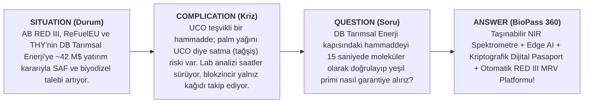
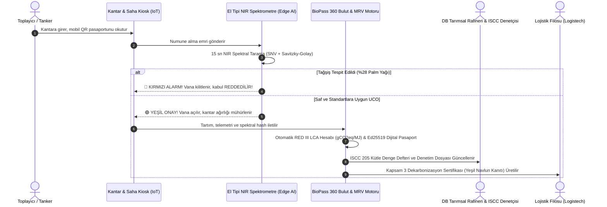
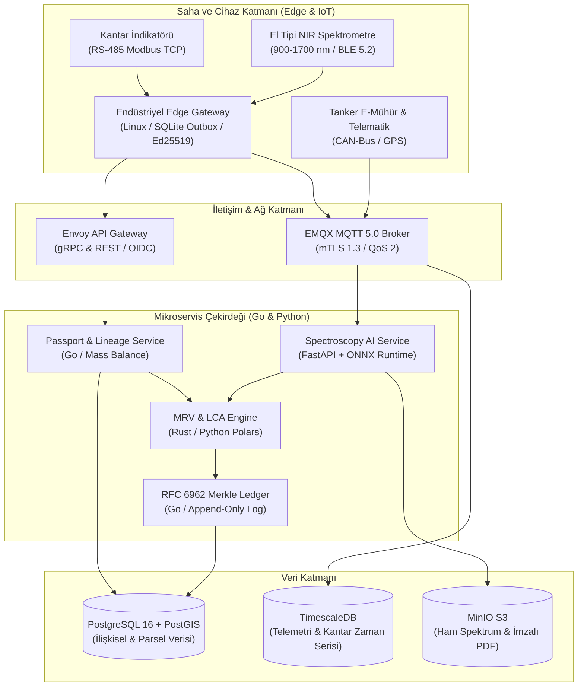
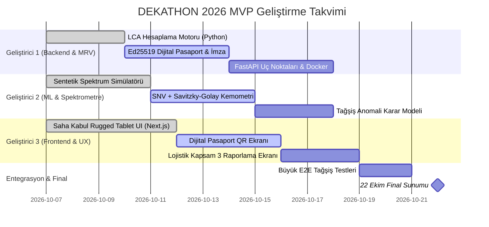

# 🌿 BioPass 360 — DEKATHON 2026 Proje Dosyası

> **Proje Adı:** BioPass 360 (Biyoyakıt ve SAF Tedarik Zincirinde Spektroskopik AI Hammadde Pasaportu & RED III Otomatize MRV Platformu)  
> **Hedef Etkinlik:** DEKATHON 2026 — Ulaşımda Karbonsuzlaşma Ideathonu (Logistech Fuarı & BAMBU GO)  
> **Düzenleyen / Ana Paydaşlar:** Dokuz Eylül Üniversitesi DEPARK BAMBU GO & **DB Tarımsal Enerji**, İZFAŞ Desteğiyle  
> **Hedef Çağrı Konusu:** **01 Biyoyakıt hammaddelerinde dijital izlenebilirlik ve MRV**

---

## 📌 İçindekiler
1. [Yönetici Özeti (SCQA Çerçevesi)](#1-yönetici-özeti)
2. [Sektörel Kriz & "The Burning Platform" (Neden Şimdi?)](#2-sektörel-kriz--the-burning-platform)
3. [Çözüm: BioPass 360 Nasıl Çalışır?](#3-çözüm-biopass-360-nasıl-çalışır)
4. [Rekabet Avantajı](#4-rekabet-avantajı)
5. [İş Modeli, Pazar Analizi & Finansal Getiri (DB Tarımsal Enerji ROI)](#5-iş-modeli-pazar-analizi--db-tarımsal-enerji-roi)
6. [Sistem Mimarisi & Teknoloji Yığını](#6-sistem-mimarisi--teknoloji-yığını)
7. [Matematiksel Model & Algoritmik Çekirdek](#7-matematiksel-model--algoritmik-çekirdek)
8. [Kullanıcı Deneyimi (UX) & Operatör Arayüzleri](#8-kullanıcı-deneyimi-ux--operatör-arayüzleri)
9. [Demo Senaryosu (3 Dakikalık Pitch, Simülasyon)](#9-demo-senaryosu-3-dakikalık-pitch-simülasyon)
10. [3 Kişilik Lisans Takımı İçin 2 Haftalık MVP Geliştirme Yol Haritası](#10-2-haftalık-mvp-geliştirme-yol-haritası)

---

## 1. Yönetici Özeti (SCQA Çerçevesi)



* **Durum (Situation):** AB RED III Direktifi ve ReFuelEU Aviation ile biyoyakıt ve Sürdürülebilir Havacılık Yakıtı (SAF) kullanımı zorunlu hale gelmiştir. Yarışmanın ana ortağı **DB Tarımsal Enerji**, Türkiye'nin büyük biyodizel üreticilerinden biridir. THY, Nisan 2026'da şirkete yaklaşık 42 milyon $ yatırım yapıp %40 ortak olma kararını açıkladı (kapanış 2026 içinde bekleniyor; hedef 2029'da 100 bin ton/yıl SAF) ([kaynak](https://www.bloomberght.com/thy-den-db-tarimsal-enerji-ye-42-milyon-dolarlik-yatirim-3773513)).
* **Karmaşa (Complication):** Kullanılmış Kızartmalık Yağ (UCO), RED II/III Annex IX Part B kapsamında teşvikli bir hammaddedir. Bu yüzden taze palm yağını asitlendirip UCO gibi satma (tağşiş) riski vardır; prim büyüklüğü *(varsayım, kaynak yok, mentorla doğrulanacak)*. Mevcut ERP'ler ve blokzincirler **"Oracle Problemi"** nedeniyle çaresizdir (fiziksel içeriği değil, sadece kağıt faturayı kaydederler). Laboratuvar analizleri saatler mertebesinde sürer; rafineri ya tankeri bekletir ya da sahte partiyi tanka alıp kalite ve sertifikasyon riskiyle karşılaşır.
* **Soru (Question):** DB Tarımsal Enerji ve lojistik filoları, hammadde orijinalliğini sahada saniyeler içinde doğrulayarak kütle dengesini, karbon yoğunluğunu ve ihracat primini nasıl garanti altına alabilir?
* **Cevap (BioPass 360):** **BioPass 360**; el tipi NIR spektroskopisi ve Edge Yapay Zeka ile **15 saniyede moleküler tağşiş tespiti** yapan, W3C uyumlu **Dijital Hammadde Pasaportu (DPP)** oluşturan ve **RED III / ISO 14064 uyumlu otomatik MRV** motoruyla denetime hazır yeşil kanıt üreten uçtan uca dekarbonizasyon platformudur.

---

## 2. Sektörel Kriz & "The Burning Platform"

Biyoyakıt ve yeşil lojistik sektörü 2026 yılı itibarıyla 4 kritik krizle yüzleşmektedir:

| Kriz Alanı | Sektör Gerçeği | Yaşanan Kayıp / Risk |
| :--- | :--- | :--- |
| **1. Tağşiş Arbitrajı (Fraud)** | 2025'te Asya'da UCO ~940-1.060 $/t aralığındaydı ([kaynak](https://www.eco-business.com/ms/news/malaysian-palm-oil-board-to-roll-out-used-cooking-oil-reference-price-to-boost-transparency-drive-circularity/)); ham palm yağıyla benzer seviye. UCO'nun teşvikli statüsü, palm yağını UCO diye satmayı kârlı kılabilir. | Tağşişli parti üretim kalitesini bozar ve **sertifikasyon riski** doğurur (kayıp büyüklüğü *(varsayım, kaynak yok, mentorla doğrulanacak)*). |
| **2. Laboratuvar Darboğazı & Demuraj** | Klasik GC/HPLC ve kimyasal lab analizleri **saatler mertebesinde** sürer. | Tankerler kapıda bekler; bekleme ve test maliyeti oluşur (tutar *(varsayım, kaynak yok, mentorla doğrulanacak)*). |
| **3. Manuel MRV & Denetim Kabusu** | RED III'e göre 2021 sonrası işletmeye giren tesislerde biyoyakıtın en az **%65** GHG tasarrufu ($gCO_2eq/MJ$) kanıtlanmalıdır. | Hesaplar parti bazında elle yapılırsa zaman kaybı ve insan hatası riski doğar (mevcut süreç *(varsayım, kaynak yok, mentorla doğrulanacak)*). |
| **4. Lojistiğin Yeşil Aklama Korkusu** | Lojistik filoları kurumsal müşterilerine Kapsam 3 emisyon düşüşü taahhüt etmektedir. | Taşımacılar aldıkları yakıtın gerçek karbon tasarrufunu kanıtlayamaz; yeşil navlun faturası kesemez. |

---

## 3. Çözüm: BioPass 360 Nasıl Çalışır?

BioPass 360, "Tarladan/Restorandan Rafineriye, Rafineriden Egzoza" uzanan 4 adımlı kapalı devre bir ekosistemdir:



### Çözümün 3 Temel Bileşeni:
1. **Moleküler Güvenlik Katmanı (Edge Chemometrics):** 900-1700 nm portatif NIR spektrometresiyle sahada 15 saniyede Serbest Yağ Asidi (FFA %), Nem/Tortu % ve Palm Yağı Tağşiş İndeksi analizi.
2. **Kriptografik Dijital Hammadde Pasaportu (DPP):** Menşe koordinatları, toplayıcı kimliği, kantar tartımı ve spektral parmak izinin Ed25519 imzasıyla değiştirilemez hale getirilmesi (Merkle-Tree kütüğü yol haritasında).
3. **Otomatize RED III MRV & Kapsam 3 Motoru:** Taşıma telemetrisi ve tesis enerji tüketimini birleştirerek partinin net sera gazı tasarrufunu ($gCO_2eq/MJ$) anında hesaplayan ve tek tıkla ISCC / EPDK uyumlu denetim raporu üreten zeka.

---

## 4. Rekabet Avantajı

BioPass 360'ı benzer fikirlerden ayıran 5 nokta:

> [!IMPORTANT]
> ### 1. "Oracle Problemine" Yaklaşım (Molekül ile Verinin Bağlanması)
> Blokzincir tabanlı takip önerileri genelde beyana dayanır. Ancak kantar başındaki şoför sisteme yalan beyan girerse, blokzincir sadece o yalanı ölümsüzleştirir (*Garbage In, Immutable Garbage Out*). BioPass 360, **fiziksel spektroskopik kimya onayı olmadan sisteme veri girişine izin vermez!**

> [!TIP]
> ### 2. DB Tarımsal Enerji & THY'nin Stratejik Yatırımına Birebir Uyum
> THY, DB Tarımsal Enerji'ye yaklaşık 42 milyon $ yatırım ve SAF tesisi kararı açıkladı ([kaynak](https://www.bloomberght.com/thy-den-db-tarimsal-enerji-ye-42-milyon-dolarlik-yatirim-3773513)). SAF ve AB ihracatında hammadde güvenilirliği sertifikasyon için kritik hale geliyor; BioPass 360 bu riski kapıda azaltmayı hedefler.

> [!NOTE]
> ### 3. Blokzincir Yerine Merkle Tree (Yol Haritasında)
> Gaz ücreti ve blok bekleme süresi olan blokzincirler yerine Certificate Transparency (RFC 6962) tarzı bir Merkle-Tree log mimarisi planlanmıştır. Bugünkü kodda henüz yoktur.

> [!TIP]
> ### 4. Lojistik Filolarına B2B Gelir Kapısı
> Proje sadece rafineriye değil, lojistik filolarına da doğrudan "Doğrulanmış Yeşil Navlun Sertifikası" vererek AB müşterilerine Kapsam 3 emisyon düşüşü satmalarını sağlar.

> [!IMPORTANT]
> ### 5. Sahada Sıfır Sürtünme
> Çiftçiye veya şoföre karmaşık formlar doldurtmaz. 15 saniyelik daldırma testi ve endüstriyel "Trafik Işığı" onayı ile çalışır.

---

## 5. İş Modeli, Pazar Analizi & DB Tarımsal Enerji ROI

### Pazar Büyüklüğü *(varsayım, kaynak yok, mentorla doğrulanacak)*
* **TAM (Total Addressable Market):** **3,85 Milyar $** (Küresel biyoyakıt, SAF ve dairesel hammadde MRV ve izlenebilirlik yazılım pazarı, 2030).
* **SAM (Serviceable Available Market):** **420 Milyon $** (Türkiye, Ege limanları ve Doğu Akdeniz biyoyakıt koridoru; yıllık ~4,5 Milyon ton hammadde).
* **SOM (Serviceable Obtainable Market - 3 Yıl):** **14,2 Milyon $** (DB Tarımsal Enerji Torbalı tesisi + THY SAF koridoru + Türkiye lisanslı UCO ağı).

### DB Tarımsal Enerji Yıllık Finansal Getirisi: Örnek Hesap (Torbalı Tesisi - 100.000 Ton/Yıl)

> ⚠️ Bu tablodaki kalemlerin hiçbiri için kaynak yoktur; hepsi varsayımdır. Gerçek rakamlar mentordan alınıp hesap yeniden yapılacaktır.

| Gelir / Tasarruf Kalemi | Açıklama | Yıllık Katma Değer |
| :--- | :--- | :--- |
| **Katalizör & Kimyasal Optimizasyonu** | Doğru FFA ve nem ölçümüyle aşırı sodyum metilat tüketiminde %18 düşüş | **+450.000 €** |
| **Tank Kontaminasyonu Önleme** | Yılda en az 1 kez gerçekleşen 1.000 tonluk tank kirlenmesi ve katalizör zehirlenmesinin önlenmesi | **+500.000 €** |
| **Demuraj & Dış Lab Tasarrufu** | 3.500 sevkiyatta saatler yerine dakikalar içinde kabul; dış laboratuvar test maliyetlerinin sıfırlanması | **+270.000 €** |
| **ISCC & RED III Yeşil Satış Primi** | Gerçek verilerle kanıtlanmış yüksek GHG tasarrufu sayesinde ton başına +55 € yeşil ihracat primi (80k ton) | **+4.400.000 €** |
| **TOPLAM YILLIK NET FAYDA** | | **5.620.000 € / Yıl** |
| **Sistem Yatırım Maliyeti (CAPEX)** | 5 Portatif NIR Spektrometre + Edge Kiosk + Bulut Entegrasyonu | **200.000 €** |
| **YATIRIM GERİ DÖNÜŞ SÜRESİ (PAYBACK)**| | ~13 gün (yukarıdaki varsayımlara bağlı, doğrulanmadı) |

---

## 6. Sistem Mimarisi & Teknoloji Yığını

Aşağıdaki hedef mimaridir. Bugünkü kodda yalnız LCA motoru, pasaport imzası ve sentetik spektrum modülleri vardır:



### Mimari Özellikler:
* **Offline-First:** Tarlada veya internetin kesildiği kırsal toplama noktalarında Flutter mobil istemcisi yerel SQLite kuyruğuna yazar, donanımsal çipte Ed25519 ile imzalar; ağ gelince çakışmasız senkronize olur.
* **Kriptografik Merkle Tree:** Her partinin hash'i bir önceki partiye bağlanır ($\text{LeafHash}_N = \text{SHA-256}(\text{BatchID} \parallel \text{PrevLeaf} \parallel \text{NIR} \parallel \text{Weight})$). Denetçi tek bir Root Hash ile partinin değiştirilmediğini $O(\log N)$ sürede doğrular.

---

## 7. Matematiksel Model & Algoritmik Çekirdek

### 7.1. RED II / RED III LCA Emisyon Hesaplama Formülü
Directive (EU) 2018/2001 Annex V ve Directive (EU) 2023/2413 uyarınca:

$$E = e_{ec} + e_l + e_p + e_{td} + e_u - e_{sca} - e_{ccs} - e_{ccr}$$

* **UCO İstisnası:** RED II Annex V Kısım C, 18. nokta gereğince atık yağlarda hammadde çıkarma ($e_{ec} = 0$), arazi kullanım değişikliği ($e_l = 0$) ve kullanım fazı ($e_u = 0$) sıfırdır.
* **Gliserin Enerji Tahsis Katsayısı (Allocation Factor):**
  $$AF = \frac{M_{\text{biyodizel}} \times 37.2}{M_{\text{biyodizel}} \times 37.2 + M_{\text{gliserin}} \times 16.0}$$
* **Sera Gazı Tasarrufu:**
  $$\text{SAVING} = \frac{94.0 - E}{94.0} \times 100$$
  *Sonuç:* Koddaki tipik UCO biyodizeli senaryosunda $E = 14.1 \, gCO_2eq/MJ$ ve **%85 sera gazı tasarrufu** çıkar (yasal eşik %65). Bugün FAME biyodizel hesaplanır; SAF (HEFA) yol haritasındadır.

### 7.2. NIR Spektroskopi Kemometrik Analizi
* **Ön İşleme (Preprocessing):** Standard Normal Variate (SNV) saçılma düzeltmesi ve Savitzky-Golay 1. türev ($w=11, p=2$) filtrelemesi.
* **Kritik Spektral Parmak İzleri:**
  * **980 nm & 1460 nm:** Toplam Polar Bileşenler (TPC %). Hakiki kızartılmış UCO'da %15-%28; taze palm yağında <%8!
  * **1205 nm:** $\text{cis-CH}=\text{CH-}$ doymamışlık bağı. Palm yağında doymuş yağ yüksek olduğundan bu pik çöker.
  * **1410 & 1720 nm:** FFA (Serbest yağ asidi) tayini.
* **Karar Kuralı:** Eğer $\text{TPC} < \%12$ ve Doymamışlık İndeksi $< 0.85$ ise sistem anında **`REJECT_FRAUD: PALM_OIL_ADULTERATION`** alarmı üretir.

---

## 8. Kullanıcı Deneyimi (UX) & Operatör Arayüzleri

Kullanıcı arayüzü, ağır sanayi sahasının zorlu koşulları düşünülerek **insan merkezli tasarım** ilkeleriyle kurgulanmıştır:

### Persona ve Saha Arayüzü:
* **Mehmet Usta (Rafineri Hammadde Kabul Şefi - 52 Yaş):**
  * Gürültülü ortamda, gres yağlı eldivenlerle çalışır. Tablet ekranında küçük yazı okuyamaz.
  * **Çözüm:** 3 Renkli Endüstriyel Trafik Işığı (Yeşil / Sarı / Kırmızı).
  * **Hata Önleyici Tasarım:** Yanlışlıkla dokunmayı önleyen **"Swipe-to-Confirm" (Kaydırarak Boşaltım Onayı)** ve tehlike anında kantar vanasını fiziksel olarak kilitleyen emniyet mandalı.

```
+---------------------------------------------------------------+
|  BIOPASS 360 // SAHA KABUL TERMINALI (Rugged UI)              |
|  Plaka: 35 DB 2026  |  Toplayıcı: Ege Atık Ltd.  |  Parti: #8842|
+---------------------------------------------------------------+
|                                                               |
|   [  O N A Y L A N D I  :  S A F   U C O  ]                   |
|   Moleküler Güven Skoru: %98.4 (Saf Kullanılmış Yağ)          |
|                                                               |
|   Kimyasal Parametreler:                                      |
|   * Serbest Yağ Asidi (FFA): %3.10  [UYGUN]                   |
|   * Nem & Tortu:             %0.08  [UYGUN]                   |
|   * Polar Bileşen (TPC):     %21.4  [UYGUN - Termal İşlem Var]|
|   * Palm Yağı Şüphesi:       %0.00  [TEMIZ]                   |
|                                                               |
|   RED III Karbon Tasarrufu:  %85.0 (14.1 gCO2eq/MJ)           |
|                                                               |
+---------------------------------------------------------------+
|  >>> [ KAYDIRARAK TANK 102'YE BOŞALTIMI ONAYLA ] >>>          |
+---------------------------------------------------------------+
```

---

## 9. Demo Senaryosu (3 Dakikalık Pitch, Simülasyon)

> **Not:** Elimizde fiziksel NIR probu yok. Kavanozlar sahne aracıdır; ekrandaki sonuçlar **sentetik spektrum simülasyonundan** gelir ve bu sunumda açıkça söylenir.

Sahneye 3 kişilik öğrenci takımı çıkar. Masaya iki adet özdeş, berrak sarı yağ kavanozu koyulur (Kavanoz A ve Kavanoz B).

* **00:00 - 00:30 | Kanca (The Hook):**  
  *(Takım Kaptanı iki kavanozu havaya kaldırır)*  
  > *"Sayın jüri üyeleri, elimde iki yağ kavanozu var. Renkleri, kokuları aynı. Biri Torbalı'daki restoranlardan toplanmış gerçek atık yağ (UCO); diğeri ise içine asit ve boya katılmış kaçak palm yağı. Birincisi teşvikli bir sürdürülebilir hammadde; ikincisi ise fabrikaya girerse üretim kalitesini ve sertifikasyonu riske atar. Bu ayrımı klasik laboratuvarda yapmak saatler sürüyor. İşte biz BioPass 360'ız; bu ayrımı kapıda 15 saniyede yapmayı hedefliyoruz. Şimdi size simülasyonla göstereceğiz."*

* **00:30 - 01:15 | 'AHA!' Anı (Simülasyon):**  
  *(Kavanoz A'yı temsil eden sentetik spektrum sisteme verilir. Sahne ekranı YEŞİL yanar)*  
  > *"Yeşil Onay! Temiz UCO. RED III karbon tasarrufu %85. Dijital Hammadde Pasaportu imzalandı."*  
  *(Kavanoz B'yi temsil eden spektrum verilir... Ekran KIRMIZI yanar)*  
  > *"🛑 TAĞŞİŞ ALARMI! %28 palm yağı stearini saptandı, parti reddedildi."*

* **01:15 - 02:00 | Pazar ve Lojistik Bağı:**  
  > *"İçeri giren temiz hammadde işleniyor ve lojistik filolarına yakıt olarak gidiyor. Onlara da kullandıkları yakıtın doğrulanmış karbon tasarrufu kanıtını veriyoruz."*

* **02:00 - 02:35 | Farkımız:**  
  > *"Kağıt evrakı blokzincire yazmak yetmez; yalanı yazarsanız yalanı ölümsüzleştirirsiniz. Biz molekülün kimyasal parmak izini dijital veriye bağlamayı hedefliyoruz."*

* **02:35 - 03:00 | Kapanış:**  
  > *"BioPass 360; kızartma tenceresinden jet motoruna kadar her damlanın namusudur. DB Tarımsal Enerji ve DEPARK ile ulaştırmanın karbonsuzlaşmasında Türkiye'yi Avrupa'nın en güvenilir üssü yapmaya hazırız!"*

---

## 10. 2 Haftalık MVP Geliştirme Yol Haritası (7 - 22 Ekim 2026)

3 kişilik lisans ekibi için gün gün planlanmış, çalışan prototip iş bölümü:



---

## 📁 Proje Dosya ve Kod Haritası
Proje kapsamında tüm çalışan Python/TypeScript modülleri, birim testleri ve mimari belgeleri diskte oluşturulmuştur:

* 🏗️ **Sistem Mimarisi:** [`docs/BIOPASS360_SYSTEM_ARCHITECTURE.md`](../docs/BIOPASS360_SYSTEM_ARCHITECTURE.md)
* 🎨 **UX ve Arayüz Tasarımı:** [`docs/BIOPASS360_UX_SPECIFICATION.md`](../docs/BIOPASS360_UX_SPECIFICATION.md)
* 🧪 **LCA Emisyon Motoru:** [`src/biopass360/mrv/lca_engine.py`](../src/biopass360/mrv/lca_engine.py) & [`lca_engine.ts`](../src/biopass360/mrv/lca_engine.ts)
* 🔬 **Spektrometre & Tağşiş Dedektörü:** [`src/biopass360/spectral/chemometrics.py`](../src/biopass360/spectral/chemometrics.py) & [`adulteration_detector.py`](../src/biopass360/spectral/adulteration_detector.py)
* 📜 **Dijital Pasaport & İmzacı:** [`src/biopass360/passport/schema.py`](../src/biopass360/passport/schema.py) & [`signer.py`](../src/biopass360/passport/signer.py)
* 🌐 **REST API Uç Noktaları:** [`src/biopass360/api/endpoints.py`](../src/biopass360/api/endpoints.py)
* ✅ **TDD Birim Testleri:** [`tests/test_lca_engine.py`](../tests/test_lca_engine.py), [`test_spectral_analysis.py`](../tests/test_spectral_analysis.py), [`test_passport_schema.py`](../tests/test_passport_schema.py)

---

## Kaynaklar
* THY'nin DB Tarımsal Enerji yatırımı (~42 M$, %40 pay, KAP Nisan 2026): [Bloomberg HT](https://www.bloomberght.com/thy-den-db-tarimsal-enerji-ye-42-milyon-dolarlik-yatirim-3773513)
* 2025 UCO fiyatları (FOB Straits, ~940-1.060 $/t): [Eco-Business / MPOB](https://www.eco-business.com/ms/news/malaysian-palm-oil-board-to-roll-out-used-cooking-oil-reference-price-to-boost-transparency-drive-circularity/)
* Bu belgedeki diğer rakamlar (pazar büyüklüğü, ROI kalemleri) varsayımdır ve mentor görüşmesinden sonra güncellenecektir.

---
*BioPass 360, DEKATHON 2026 Ideathonu için hazırlanmıştır.*
