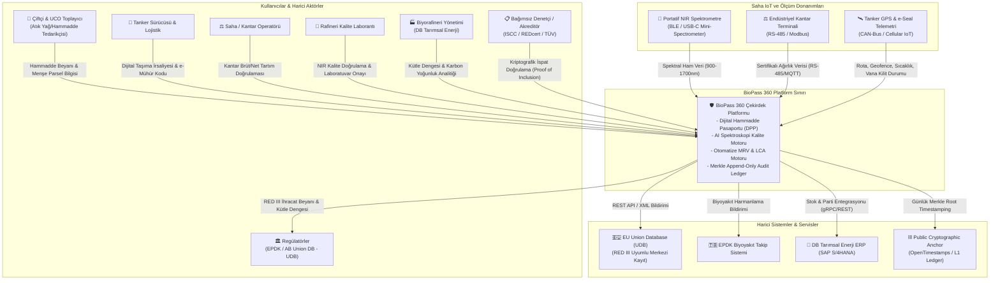
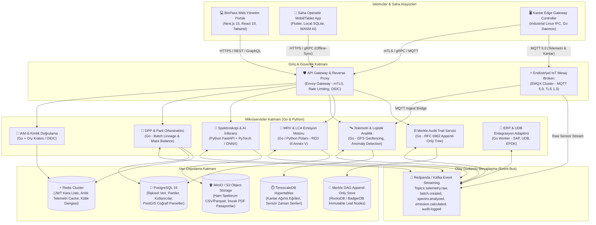
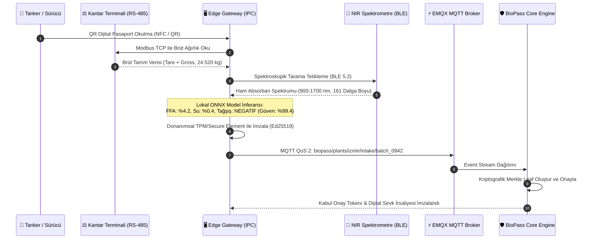
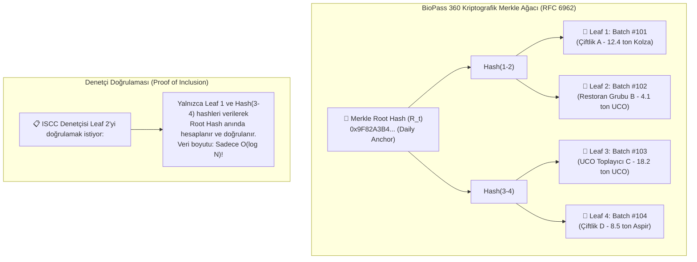
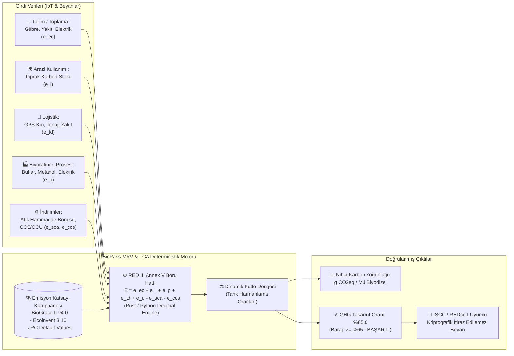
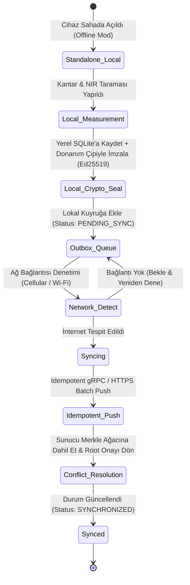

# BioPass 360: Sistem Mimarisi ve Teknik Spesifikasyon Dokümanı

> **Not:** Bu belge projenin uzun vadeli hedef tasarımıdır. Buradaki teknoloji yığını ve rakamların çoğu hedef ya da varsayımdır. Bugün neyin çalıştığı [README](../../README.md)'de yazıyor.

**DEKATHON 2026 — Dokuz Eylül Teknoloji Geliştirme Bölgesi & DB Tarımsal Enerji**
**Konsept:** Biyoyakıt Tedarik Zincirinde Yapay Zeka Destekli Dijital Hammadde Pasaportu, Spektroskopik Kalite Doğrulama ve RED III Uyumlu Otomatize MRV Platformu
**Durum:** Hedef mimari. Bugünkü kodda yalnız LCA motoru, pasaport imzası ve sentetik spektrum modülleri vardır.

---

## 0. Mimari İlkeler ve Tasarım İnvariantları (Foundations)

Bu mimari, hatalara dayanıklılık, net alan sınırları ve pragmatik modülerlik ilkeleri temel alınarak tasarlanmıştır.

### Temel İnvariantlar (Architectural Invariants)
1. **İmmutability by Design (Değiştirilemezlik Prensibi):** Saha kabul noktasında kantar, spektrometre veya GPS tarafından üretilen hiçbir birincil ölçüm verisi (raw ingest) update/delete işlemine tabi tutulamaz. Sistem yalnızca append-only (eklemeli) ve kriptografik zincirlemeyle çalışır.
2. **Offline-First Resilience (Ağdan Bağımsız Çalışabilirlik):** Kırsal alanlarda, tarla kenarlarında veya yer altı depolama sahalarında internet bağlantısı kopsa dahi saha terminali hammadde kabulü yapabilmeli, spektrometrik taramayı yerel AI modeliyle çalıştırabilmeli ve veriyi donanımsal olarak imzalayıp lokalde güvenle kuyruğa alabilmelidir.
3. **Yerleşik ve Yeni Teknoloji Ayrımı:** Çekirdek veri saklama ve işleme katmanında yaygın ve olgun teknolojiler (PostgreSQL, Go, Linux IPC) kullanılırken; yenilikçi teknoloji yalnızca iki noktada kullanılır:
   - *Fark 1:* Portatif NIR (Near-Infrared) spektrum verisinden gerçek zamanlı kimyasal tağşiş/kalite kestirimi yapan yerel edge AI motoru.
   - *Fark 2:* Biyorafineri harmanlama tanklarında kütle dengesini (mass balancing) kriptografik Merkle-DAG ile takip eden dijital soykütüğü (lineage engine).
4. **Kriptografik İspatlanabilirlik (Bağımsız Denetlenebilirlik):** Sistem, merkezi veritabanı yöneticisine (DBA) dahi güven duyulmasını gerektirmez. Her kabul partisi (batch), çift yönlü kriptografik hashleme ve Merkle Tree logları ile bağımsız denetçilere (ISCC, REDcert, TÜV) matematiksel olarak doğrulanabilir kanıt sunar.

---

## 1. Genel Sistem Mimarisi (C4 Seviye 1 & Seviye 2)

### 1.1. C4 Seviye 1: Sistem Bağlam Diyagramı (System Context Diagram)

BioPass 360 platformunun harici paydaşlar, IoT donanımları ve regülatif sistemlerle olan sınırları aşağıda gösterilmiştir:



---

### 1.2. C4 Seviye 2: Konteyner Diyagramı (Container Diagram)

Platformun mikroservisleri, mesaj kuyrukları ve depolama katmanları arasındaki etkileşim şeması:



---

## 2. IoT ve Sensör Entegrasyonu (Hardware-to-Cloud Pipeline)

Biyoyakıt tedarik zincirinde (özellikle Bitkisel Atık Yağ - UCO, Pirina yağı, Kanola ve Aspir gibi hammaddelerde) en büyük risk; **tağşiş (mineral yağ veya su karıştırılması)**, **yolda kaçak boşaltma** ve **sahte menşe beyanıdır**. BioPass 360, saha kabul noktalarını tam otomatik dijital korumaya alır.



### 2.1. Donanım Arayüzleri ve Protokol Spesifikasyonları

1. **Portatif NIR Spektrometreleri:**
   - **Donanım:** DLP NIRScan Nano EVM veya Hamamatsu Mini-spectrometer modülü tabanlı portatif el cihazı.
   - **Dalga Boyu Aralığı:** 900 nm – 1700 nm (opsiyonel uzatılmış InGaAs sensör ile 1350 – 2500 nm).
   - **İletişim:** BLE 5.2 (GATT Profil) veya USB-C OTG (VCP - Virtual COM Port).
   - **Ölçüm Parametreleri:**
     - Serbest Yağ Asidi (FFA - Free Fatty Acids) % tayini (biyorafineri esterleşme kimyasal girdi hesabı için).
     - Nem ve Uçucu Madde (%) tayini.
     - İyot Değeri (Iodine Value) ve Polar Madde içeriği.
     - Mineral Yağ (Madeni Yağ / Tağşiş) Varlığı (Hidrokarbon pikleri 1200nm ve 1730nm anomali tespiti).

2. **Endüstriyel Kantar (Weighbridge) Entegrasyonu:**
   - **Standart Arayüz:** Mettler Toledo Toledo IND570 veya Tunaylar endüstriyel tartım indikatörleri.
   - **Fiziksel Bağlantı:** İzole RS-485 veya TCP/IP Ethernet.
   - **Protokol:** Modbus RTU / Modbus TCP veya Sürekli Veri Akışı (Continuous Output 9600 baud, 8-N-1).
   - **Anti-Fraud (Hile Önleme) Algoritması:** Kantara araç girdiğinde ağırlık stabilizasyon eğrisi (settling curve) 100 Hz ile örneklenir; darbe veya harici yük manipülasyonu tespit edilirse kabul engellenir.

3. **Tanker Telemetrisi ve Lojistik İzleme:**
   - **Cihaz:** Teltonika FMC130 / Queclink GL300 veya eşdeğeri IP67 araç telemetri ünitesi.
   - **Ağ:** 4G LTE Cat-M1 / NB-IoT (2G fallback).
   - **Sensörler:**
     - GPS/GLONASS (1 Hz konum, hız, rakım).
     - Dijital Kilit Mührü (BLE Electronic Seal): Tanker vana kapakları açıldığında anında alarm ve olay kaydı (tamper detection).
     - Tank Seviye Sensörü: Ultrasonik / Hidrostatik basınç sensörü (yolda yakıt boşaltma tespiti).

### 2.2. MQTT Topic Hiyerarşisi ve QoS Tasarımı

EMQX Broker üzerinde çalışan standartlaştırılmış topic mimarisi:

| Topic Kalıbı | Mesaj Tipi | QoS Düzeyi | Veri Tipi / Yük | Sıklık |
| :--- | :--- | :--- | :--- | :--- |
| `biopass/v1/telemetry/{vehicle_id}/gps` | Konum / Hız / Odometre | **QoS 0** | Protobuf / JSON (Geçici telemetri) | Her 10 sn |
| `biopass/v1/telemetry/{vehicle_id}/alerts` | E-Seal Açıldı / Geofence İhlali | **QoS 1** | Protobuf + İmzalı Alarm | Anlık (Olay anında) |
| `biopass/v1/plants/{plant_id}/scales/{scale_id}/weight` | Kantar Tartım Kaydı | **QoS 2** | JSON + Donanım İmzası | Tartım tamamlandığında |
| `biopass/v1/plants/{plant_id}/intake/nir_raw` | NIR Spektral Verisi | **QoS 2** | Gzip Parquet / Float Array | Her numune alımında |
| `biopass/v1/plants/{plant_id}/intake/decision` | Kabul / Ret Emri | **QoS 2** | Kriptografik Kabul Sertifikası | Tek seferlik |

---

## 3. Veri Bütünlüğü ve Güvenlik (Cryptographic Provenance Engine)

### 3.1. Architecture Decision Record (ADR-001): Neden Blokzincir Değil de Merkle Tree / Trillian İmmutable Log?

| Kriter | Public/Consortium Blokzincir (Ethereum / Hyperledger Fabric) | BioPass 360 Merkle Tree Log (RFC 6962 / Trillian) | Mimari Tercih Nedeni |
| :--- | :--- | :--- | :--- |
| **İşlem Maliyeti (Gas Fee)** | Yüksek / Değişken (Her parti kabulü $0.05 - $5 maliyet yaratır) | **Sıfır ek maliyet** (Standart sunucu CPU/disk maliyeti) | Milyonlarca tonluk hammadde akışında marjinal işlem maliyeti kabul edilemez. |
| **Throughput & Latency** | 15 – 3,000 TPS; blok bekleme süresi 2 – 15 saniye | **50,000+ TPS**; mikrosaniye seviyesinde ekleme | Kantar başında bekleyen kamyon trafiğinde sıfır gecikme şarttır. |
| **KVKK / GDPR / Unutulma Hakkı** | ❌ Yapısal olarak uyumsuz (Zincire yazılan veri silinemez, regülasyon cezası riski) |  Uyumlu (Kişisel veriler off-chain tutulur, sadece tuzlanmış kriptografik hash loglanır) | Sürücü kimliği, plaka ve çiftçi bilgileri gerektiğinde kriptografik parçalama (cryptographic shredding) ile silinebilir. |
| **Operasyonel Karmaşıklık** | Çok yüksek (Validator node'ları, consensus mekanizması, smart contract bug riski) | **Düşük / Yalın** (Google Certificate Transparency tarafından kanıtlanmış kütüphaneler) | Endüstriyel sahada bakım kolaylığı esastır. |
| **Denetçi Doğrulaması** | Zor (Denetçinin tam node kurması veya karmaşık RPC sorgulaması gerekir) | **Mükemmel (O(log N))**: Denetçiye birkaç kilobaytlık Merkle Path verilerek bağımsız doğrulanır | ISCC denetçisi internete dahi ihtiyaç duymadan offline CLI aracıyla doğrular. |

### 3.2. Çift Yönlü Kriptografik Hashleme ve Soykütüğü (Bilateral Chaining)

Her hammadde kabul partisi ($Batch_N$), bir önceki partinin kriptografik durumunu ve saha sensörlerinin özetini bağlar:

$$\text{LeafHash}_N = \text{SHA-256}\Big(\text{BatchID} \parallel \text{PrevLeafHash}_{N-1} \parallel \text{NIR\_SpectralHash} \parallel \text{ScaleWeightHash} \parallel \text{GeoCoordinates} \parallel \text{Timestamp} \parallel \text{Sign}_{\text{EdgeDevice}}(\text{Payload})\Big)$$



### 3.3. Donanımsal İmza (Hardware Security & TPM 2.0)
Saha Edge Gateway'lerinde **Microchip ATECC608A** veya standart **TPM 2.0 (Trusted Platform Module)** donanımı bulunur. Özel anahtarlar (Private Key - Ed25519) donanımdan asla dışarı çıkarılamaz. Sensörden gelen kantar ve spektrometre verisi, doğrudan bu güvenli çip içerisinde imzalanarak `biopass-signature` başlığıyla API'ye iletilir.

---

## 4. MRV ve LCA Emisyon Hesaplama Motoru Mimarisi

BioPass 360 MRV motoru, **RED III (Yenilenebilir Enerji Direktifi III - AB 2023/2413 Direktifi)** Annex V, **ISO 14064-1/2** ve **ISO 14067 (Ürün Karbon Ayak İzi)** standartlarını birebir implemente eder.



### 4.1. RED III Annex V Formülasyonu ve Değişkenleri

Platform aşağıdaki ana denklem üzerinden hesaplama yapar:

$$E = e_{ec} + e_l + e_p + e_{td} + e_u - e_{sca} - e_{ccs} - e_{ccr}$$

Burada:
- **$e_{ec}$ (Hammadde Çıkarma/Üretim):** Bitkisel yağlarda tohum, suni azotlu gübre ($N_2O$ katsayıları), tarla traktör dizeli. **UCO (Bitkisel Atık Yağ) için $e_{ec} = 0$ kabul edilir (Atık statüsü).**
- **$e_l$ (Arazi Kullanım Değişikliği - Land Use Change):** Karbon stoku değişimi. Biyoyakıt hammaddesi yetiştirilen arazinin 2008 öncesi/sonrası durumu (EUDR Ormansızlaşma Direktifi doğrulaması).
- **$e_p$ (İşleme Emisyonları):** Biyorafineride kullanılan proses buharı (doğalgaz/biyokütle kazanı), şebeke elektriği ve kimyasal reaktifler (metanol tüketimi: $\sim 100 \text{ kg} / \text{ton biyodizel}$, sodyum metilat katalizörü).
- **$e_{td}$ (Taşıma ve Dağıtım):** Tanker telemetrisinden (GPS) gelen gerçek mesafe ($km$), taşınan brüt tonaj ($ton$) ve aracın spesifik yakıt tüketim katsayısı ($g CO_{2}eq / ton\cdot km$).
- **$e_u$ (Kullanım Anı Emisyonu):** Biyoyakıtlarda sıfır ($0$) kabul edilir.
- **$e_{sca}$ (Tarımsal Karbon İyileştirme):** Uygun tarım uygulamalarıyla toprakta tutulan karbon kredisi.
- **$e_{ccs} / e_{ccr}$:** Karbon yakalama ve jeolojik depolama/değiştirme indirimleri.

### 4.2. Sera Gazı (GHG) Tasarrufu Hesaplama Kriteri

RED III regülasyonuna göre nihai biyoyakıtın fosil yakıt referansına ($E_F = 94 \text{ g CO}_2\text{eq/MJ}$) göre asgari **%65 sera gazı tasarrufu** sağlaması şarttır:

$$\text{Tasarruf} = \frac{E_F - E_B}{E_F} \times 100 \ge \%65$$

BioPass 360 MRV motoru, parti bazında bu katsayıyı gerçek zamanlı hesaplayarak kural ihlallerinde partinin "Sürdürülemez / Regülasyon Dışı" olarak etiketlenmesini sağlar.

### 4.3. Biyorafineri Kütle Dengesi (Mass Balance Book-and-Claim Modeli)
Biyorafinerilerde (örn. DB Tarımsal Enerji tesislerinde) depolama tanklarına farklı emisyon değerlerine sahip hammaddeler (örn. UCO: %88 tasarruf, Kanola: %62 tasarruf, Pirina: %74 tasarruf) aynı fiziksel tanka boşaltılabilir.
BioPass 360, **ISCC 205 (Mass Balance)** kural motorunu dijitalleştirir:
- Fiziksel karışım yapılırken sistemsel sanal envanterde karbon yoğunluğu ağırlıklı ortalama ile değil, parti kredi transferi yöntemiyle ve korunumlu olarak temsil edilir ($Input_{GHG\_Credits} = Output_{GHG\_Credits}$).
- Negatif kredi yaratılması fiziksel ve mantıksal olarak kısıtlanır.

---

## 5. Teknoloji Yığını ve Seçim Gerekçeleri 

Aşağıdaki tablo yerleşik bileşenleri ve projeye özgü yenilikçi bileşenleri ayırır:

| Katman | Seçilen Teknoloji | Değerlendirilen Alternatifler | Karar Gerekçesi (Architectural Rationale) | Tip |
| :--- | :--- | :--- | :--- | :--- |
| **Backend Çekirdek Servisler** | **Go (Golang 1.23+)** | Java (Spring Boot), Node.js, Rust | Düşük bellek tüketimi (<30MB RAM/servis), milisaniyenin altında soğuk başlama, tek statik binary dağıtımı, mükemmel concurrency (goroutines). | **Boring & Robust** |
| **AI / Spektroskopi / LCA Motoru** | **Python 3.12 (FastAPI + Polars + ONNX)** | R, C++ | Bilimsel kemometri (Chemometrics) kütüphaneleri (SciPy, Scikit-learn, PyTorch) ekosistemi. Polars ile sıfır gecikmeli vectorized veri analizi. | **Pragmatic Specialized** |
| **Frontend Web Portalı** | **Next.js 15 (React 19) + Tailwind + Shadcn** | Angular, Vue/Nuxt | Kurumsal gösterge panellerinde yüksek geliştirme hızı, tip güvenliği (TypeScript), SSR ile hızlı ilk yükleme ve rol bazlı erişim kolaylığı. | **Boring Standard** |
| **Saha / Mobil İstemci** | **Flutter (Dart) + SQLite** | React Native, Native Kotlin/Swift | Endüstriyel el terminalleri, tabletler ve akıllı telefonlarda tek kod tabanı. Mükemmel çevrimdışı (offline) performans ve donanım (BLE/USB) erişimi. | **Pragmatic Cross-Platform** |
| **İlişkisel Veritabanı & Mekansal Veri** | **PostgreSQL 16 + PostGIS** | MySQL, Oracle | Tarla parselleri ve rotalar için rakipsiz coğrafi sorgulama (GIS), ACID garantisi, JSONB desteği. Kaya gibi sağlam endüstri standardı. | **Boring Rock-Solid** |
| **Zaman Serisi Veritabanı** | **TimescaleDB (PostgreSQL Extension)** | InfluxDB, Prometheus | İkinci bir veritabanı operasyon yükü yaratmadan PostgreSQL içinde kantar ağırlık eğrilerini ve telemetriyi hiper-tablolarda sıkıştırma. | **Boring & Pragmatic** |
| **Event Streaming & Mesajlaşma** | **Redpanda (C++ Kafka API)** | Apache Kafka (JVM), RabbitMQ | Kafka API uyumlu fakat ZooKeeper/JVM karmaşası yok; C++ ile ultra düşük gecikme ve minimum donanım kaynağı tüketimi. | **Pragmatic High-Perf** |
| **Endüstriyel IoT Broker** | **EMQX (Open Source)** | Mosquitto, HiveMQ Enterprise | Milyonlarca eşzamanlı MQTT 5.0 bağlantısı, dahili Rule Engine ve webhook desteği, endüstriyel güvenilirlik. | **Proven Industrial** |
| **Nesne / Doküman Depolama** | **MinIO (Self-hosted S3)** | Ceph, AWS S3 Direct | Şirket içi (On-Premise / DB Tarımsal Enerji veri merkezi) kurulum imkanı, S3 API uyumluluğu, ham spektrometre sinyal dosyaları için yüksek hız. | **Boring Cloud-Native** |
| **Kriptografik İmmutable Log** | **Google Trillian / Custom Merkle DAG (Go)** | Hyperledger Fabric, Ethereum L2 | Blokzincirin hantallığı olmadan RFC 6962 standartlarında append-only verifiable log. Sıfır gas fee, mikrosaniye hız. | **🚀 INNOVATIVE MOAT** |
| **Edge Chemometrics AI Runtime** | **ONNX Runtime (WASM / C++ Go FFI)** | TensorFlow Lite | Spektrometre gürültü arındırma (Standard Normal Variate - SNV + Savitzky-Golay) ve kimyasal sınıflandırmayı saha cihazında internetsiz <50ms'de çalıştırma. | **🚀 INNOVATIVE MOAT** |

---

## 6. Ölçeklenebilirlik, Offline-First Çalışma ve Sistem Güvenliği

### 6.1. Offline-First Çalışma Mimarisi (Kırsal Saha Dayanıklılığı)

Biyoyakıt hammaddeleri (örneğin Trakya'da kanola tarlası, Konya ovasında aspir hasadı veya şehir dışındaki atık toplama depoları) çoğunlukla hücresel kapsamanın zayıf olduğu bölgelerdedir.



#### Offline Senkronizasyon Protokolü:
1. **Local Outbox & Event Sourcing:** Mobil cihazdaki her işlem lokal bir `event` olarak SQLite içine yazılır (`BatchCreatedEvent`, `SpectralSampleAttachedEvent`, `TareWeighedEvent`).
2. **Kriptografik Bütünlük:** Veri yerel cihazdayken değiştirilemez; TPM çipi her event'in hash'ini o anki yerel zaman damgası ve GPS koordinatıyla mühürler.
3. **Idempotent Ingestion:** Bağlantı sağlandığında istemci `UUIDv7` tabanlı tekil işlem ID'si ile sunucuya paket gönderir. Ağ kopması durumunda aynı veri tekrar gönderilse dahi sunucu `Idempotency-Key` sayesinde veriyi çift işlemez.
4. **Çakışma Yönetimi (Conflict-Free Replicated Data):** Kütle dengesi hesapları sunucu tarafında doğrulanır; istemci sadece ölçüm aktarır, stok kararını merkezi otorite nihai Merkle ağacına ekleyerek onaylar.

### 6.2. Uçtan Uca Güvenlik Mimarisi (Defense-in-Depth)

1. **Ağ Güvenliği ve Zero-Trust:**
   - Saha Edge Gateway'leri ile bulut platform arasındaki tüm iletişim **Mutual TLS (mTLS 1.3)** ile korunur. Hem istemci hem sunucu birbirlerinin X.509 sertifikalarını doğrular.
   - Açık internete bakan bileşenler sadece Envoy API Gateway'dir; mikroservisler ve veritabanları izole bir overlay ağda (WireGuard / Kubernetes CNI Calico) çalışır.
2. **Kimlik ve Erişim Yönetimi (RBAC & ABAC):**
   - **Roller:** `FARMER`, `TRANSPORTER`, `WEIGHBRIDGE_OPERATOR`, `LAB_ANALYST`, `PLANT_MANAGER`, `ISCC_AUDITOR`, `REGULATOR_EPDK`.
   - **Öznitelik Bazlı Erişim (ABAC):** Örneğin bir kantar operatörü yalnızca kendi atandığı tesisin (`Plant_ID == Operator.Assigned_Plant`) tartım indikatörlerine ve o günkü sevkiyat partilerine erişebilir.
3. **Veri Güvenliği (At-Rest & In-Transit):**
   - Veritabanı diskleri LUKS (AES-256) ile şifrelidir.
   - Hassas alanlar (tedarikçi ticari fiyatları, kişisel kimlik verileri) uygulama katmanında **Envelope Encryption** (KMS / HashiCorp Vault) ile kolon bazında şifrelenir.
4. **Audit Trail Bütünlüğü:**
   - Merkle Tree logları WORM (Write Once, Read Many) prensibine göre saklanır.
   - Günlük Merkle Kök Hash'i (Root Hash), kamuya açık ve manipülasyonu imkansız bir zaman damgalama protokolüne (OpenTimestamps / L1 Bitcoin timestamping) çıpalanarak sistem yöneticilerinin dahi geçmişi değiştiremeyeceği garanti altına alınır.

---

## 7. Örnek Veri Modeli ve Protokol Spesifikasyonu (JSON Schema)

BioPass 360 Dijital Hammadde Pasaportunun (Digital Product Passport - DPP) çekirdek JSON veri yapısı:

```json
{
  "$schema": "https://json-schema.biopass360.io/v1/dpp-schema.json",
  "passport_id": "urn:biopass:batch:2026:db-izmir:948201",
  "version": "1.0.0",
  "created_at": "2026-10-13T14:32:00Z",
  "feedstock": {
    "type": "USED_COOKING_OIL",
    "cn_code": "15180095",
    "red_category": "ANNEX_IX_PART_B",
    "origin": {
      "country": "TR",
      "region": "Ege",
      "collector_id": "COL-35-DB-094",
      "source_facility_type": "RESTAURANT_CHAIN",
      "geofence_centroid": { "lat": 38.4192, "lon": 27.1287 }
    }
  },
  "logistics": {
    "transporter_id": "LOG-TR-35-8841",
    "vehicle_plate": "35DBE2026",
    "e_seal_id": "ESEAL-99841",
    "route_distance_km": 68.4,
    "departure_at": "2026-10-13T11:00:00Z",
    "arrival_at": "2026-10-13T13:45:00Z",
    "telemetry_integrity": "VERIFIED_NO_GEOFENCE_BREACH"
  },
  "intake_verification": {
    "plant_id": "PLANT-DB-TORBALI",
    "scale_ticket_no": "KNT-2026-88124",
    "gross_weight_kg": 24520,
    "tare_weight_kg": 10240,
    "net_weight_kg": 14280,
    "spectroscopy_analysis": {
      "device_sn": "NIR-NANO-0042",
      "model_version": "UCO_CHEMOMETRICS_V3_2",
      "parameters": {
        "free_fatty_acids_pct": 3.8,
        "moisture_impurity_pct": 0.42,
        "iodine_value": 105.2,
        "adulteration_flag": false,
        "mineral_oil_detected": false
      },
      "raw_spectrum_storage_ref": "s3://spectra/2026/10/13/948201_raw.parquet",
      "spectral_sha256": "8a3f81e8b9195b2d2f7f1741bb164e22543d8e5e6e3c1a2f44d715b9c7e0c4a1"
    }
  },
  "mrv_emissions": {
    "standard": "RED_III_ANNEX_V",
    "calculation_method": "ACTUAL_VALUE",
    "e_ec": 0.0,
    "e_l": 0.0,
    "e_p": 11.4,
    "e_td": 1.82,
    "e_u": 0.0,
    "e_sca": 0.0,
    "total_ghg_gco2eq_per_mj": 13.22,
    "fossil_fuel_comparator": 94.0,
    "ghg_savings_pct": 85.94,
    "compliance_status": "COMPLIANT_ABOVE_65_PCT"
  },
  "cryptographic_provenance": {
    "leaf_index": 10482,
    "prev_leaf_hash": "c4827d091b6e8f4983e9b119a0a8112e43f54d1933b9e1183cf9c988b0a1d942",
    "current_leaf_hash": "7d91fa12e56488a0b0d1e2f90a98c5512b4e89921c5f3b77810aa04e12ff9801",
    "edge_device_ed25519_signature": "MEQCIG9Xw1k+9v4B...",
    "merkle_root_anchored": "0x9F82A3B448C1895B3092AE91C..."
  }
}
```

---

## 8. Özet ve Sonuç: Sistemin Yarattığı Değer Önerisi

**BioPass 360**, biyoyakıt sektörünün karşı karşıya olduğu üç büyük problemi tek bir mimari çatıda çözer:
1. **Güven ve Tağşiş Problemi:** Laboratuvara numune göndermeden 15 saniye içinde portatif NIR spektrometresi ve yerel AI ile kimyasal saflığı sahada garanti eder.
2. **Yeşil Aklama (Greenwashing) ve Regülasyon Riski:** RED III Annex V ve ISO 14064 uyumlu emisyon motoru ile her partinin karbon yoğunluğunu gerçek IoT verileriyle hesaplayıp kütle dengesini korur; AB Union Database (UDB) entegrasyonuyla ihracat kapılarını açar.
3. **Maliyet ve Denetim Yükü:** Hantal blokzincirler yerine yüksek performanslı Merkle Tree mimarisi kullanarak bağımsız denetçilere saniyeler içinde doğrulanabilir, tahrif edilemez kriptografik kanıt sunar.
